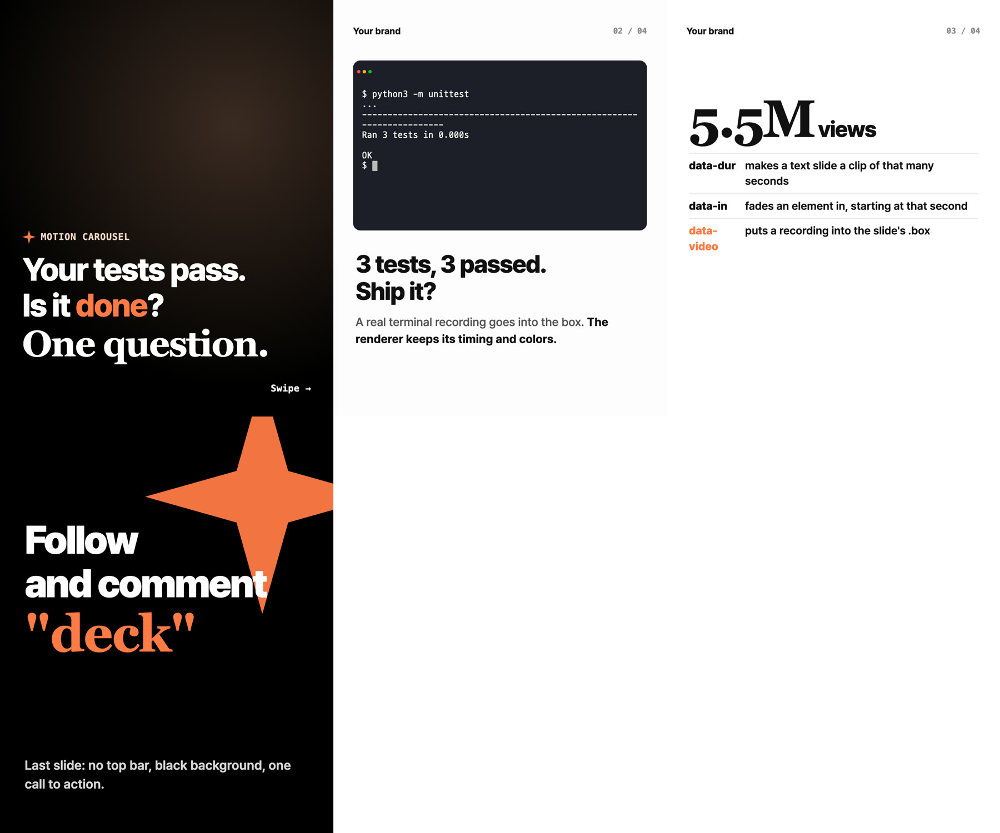

# motion-carousel

Write an Instagram carousel as one HTML file and render every card to a 1080x1350 MP4 (for video carousels) and a PNG (for still ones). Text cards get frame-accurate entrance animation. Demo cards take a real screen recording and place it into the card's media box, keeping the recording's own timing and colors.



## Why

Most carousel generators export still images. Tools that output video either record the browser in real time (dropped frames, uneven timing) or re-encode screen captures inside the page. motion-carousel steps a deterministic clock one frame at a time and composites recordings with ffmpeg instead, so the same deck always renders to the same frames.

## Requirements

- [Bun](https://bun.sh) 1.1+
- Google Chrome (or pass `--chrome /path/to/chrome`)
- `ffmpeg` on `PATH`

## Use

```bash
bunx github:seungwonme/motion-carousel new my-deck        # copy the starter deck
bunx github:seungwonme/motion-carousel preview my-deck/deck.html
bunx github:seungwonme/motion-carousel render my-deck/deck.html
```

From a clone: `bun install`, then `bun bin/motion-carousel.ts <command>`.

| Command | What it does |
|---|---|
| `render <deck.html> [--out dir] [--only 2,5] [--chrome path]` | Writes `slide-NN.mp4`, `slide-NN.png` and `contact-sheet.jpg` to `out/` next to the deck |
| `preview <deck.html> [--port 4321]` | Serves the deck. `?s=3` shows one card, `?preview` shows a grid |
| `new <dir>` | Copies `examples/basic` as a starting point |

## Writing a deck

A deck is a plain HTML file. The renderer serves the deck's folder at `/` and this package at `/_mc/`, so a deck loads the shared layout and runtime like this:

```html
<link rel="stylesheet" href="/_mc/layouts/editorial.css">
...
<section class="slide" data-dur="5">
  <div class="desc"><h2 data-in="0.2">Your tests pass.</h2></div>
</section>

<section class="slide" data-video="rec/demo.mp4">
  <div class="box"><video muted playsinline src="rec/demo.mp4"></video></div>
  <div class="desc"><h2>Ship it?</h2></div>
</section>

<script>window.CAROUSEL = { brand: { name: "Acme", logo: { onLight: "logo-black.png", onDark: "logo-white.png" } } };</script>
<script src="/_mc/runtime/carousel.js"></script>
```

| Markup | Effect |
|---|---|
| `.slide` | One 1080x1350 card |
| `data-dur="5"` | Text card rendered as a 5 s clip |
| `data-video="path.mp4"` | Recording placed into the card's `.box`; the clip runs as long as the recording |
| `data-in="0.4"` | Element fades and rises in 0.4 s into the card |
| `data-noframe` | No top bar (brand + `NN / NN` counter) on this card |
| `class="dark"` | Top bar uses the dark-background logo and colors |
| `<span class="icon" data-icon="name">` | Filled from `<template id="icon-name">` |

The `editorial` layout provides `cover`, `box`, `desc`, `who`, `big`, `steps`, `quote`, `kicker` and `cta` blocks. Restyle it with CSS variables (`--accent`, `--accent-soft`, `--sans`, `--serif`, `--mono`) or your own rules after the link.

Recordings: any MP4 works. [VHS](https://github.com/charmbracelet/vhs) tapes are a good way to make terminal recordings that re-render identically.

## How rendering works

1. Bun serves the deck on `127.0.0.1` and Playwright opens it in Chrome at 1080x1350, device scale 1.
2. For a text card, the runtime's `render(index, seconds)` is called for every frame at 30 fps and each screenshot is piped to ffmpeg (H.264, `yuv420p`, CRF 18).
3. For a recording card, the card is drawn once with the video hidden, the `.box` rectangle is measured, and ffmpeg scales the recording into that rectangle over the still.
4. The last frame of each clip is saved as the PNG, and the PNGs are tiled into a 3-column contact sheet.

## License

MIT
